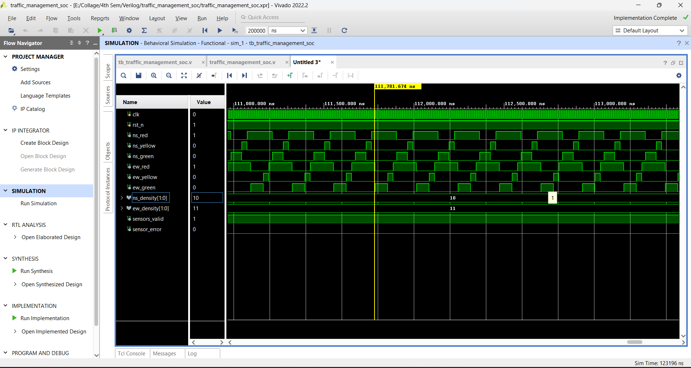
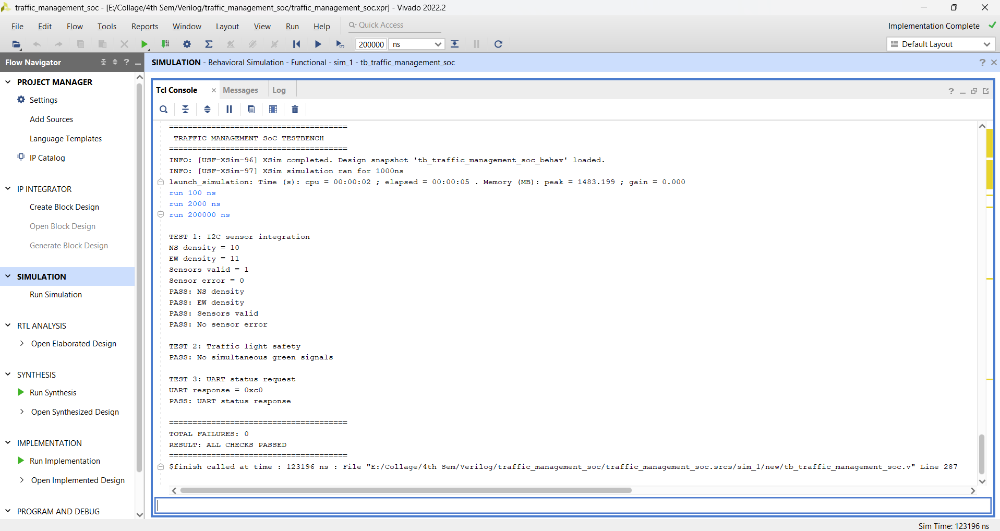
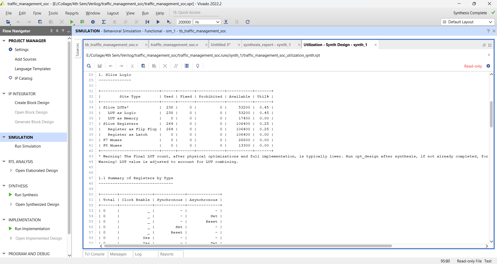

# Reconfigurable Intelligent Traffic Management SoC

**An adaptive traffic-light controller designed using Verilog HDL, integrating UART communication and an I²C sensor interface.**


---

## 1. Project Overview

The **Reconfigurable Intelligent Traffic Management SoC** is an RTL-based digital traffic control system designed to manage traffic signals according to configurable traffic-density levels.

Traditional traffic-light controllers generally operate with fixed timing intervals. This project introduces configurable green-light durations based on traffic density, allowing the controller to respond to different traffic conditions.

The design integrates a traffic management controller, configurable timer, UART communication interface, UART command decoder, I²C master, and traffic sensor interface.

The complete RTL design was developed and simulated using AMD/Xilinx Vivado 2022.2.

## 2. Project Objectives

- Design an adaptive traffic-light controller using Verilog HDL.
- Implement an FSM-based traffic signal sequencing mechanism.
- Support four configurable traffic-density levels.
- Integrate UART communication for configuration and status monitoring.
- Implement an I²C interface for external sensor communication.
- Verify the integrated design through Verilog testbenches.
- Analyze FPGA synthesis resource utilization and timing performance.

## 3. System Architecture

The design consists of the following major functional blocks:

| Module | Description |
|---|---|
| Traffic Management Core | Controls North-South and East-West traffic signal sequences. |
| Configurable Timer | Generates programmable timing intervals. |
| UART Receiver | Receives serial configuration commands. |
| UART Transmitter | Sends status responses. |
| UART Command Decoder | Decodes commands and updates density settings. |
| I²C Master | Handles I²C communication with external sensor devices. |
| Traffic Sensor Interface | Processes sensor information and provides density values. |
| Top-Level SoC | Integrates all functional modules. |

### Functional Architecture

```text
                 UART Interface
                      |
              UART Command Decoder
                      |
                      v
              Density Configuration
                      |
                      |
I²C Sensors --> I²C Master
                      |
              Sensor Interface
                      |
                      v
              Density Selection
                      |
                      v
             Traffic Management
                    Core
                      |
              Configurable Timer
                      |
                      v
               Traffic Signals
                      |
          -------------------------
          |                       |
       North-South             East-West
       Red/Yellow/Green        Red/Yellow/Green
```

## 4. Traffic Density Configuration

The controller supports four traffic-density levels.

| Density Code | Traffic Level |
|---|---|
| 00 | Low |
| 01 | Medium |
| 10 | High |
| 11 | Very High |

The controller selects the corresponding green-light duration based on the configured density level.

The default timing parameters used in the design are:

| Traffic Phase | Duration |
|---|---:|
| Low-density green | 5 clock cycles |
| Medium-density green | 10 clock cycles |
| High-density green | 15 clock cycles |
| Very-high-density green | 20 clock cycles |
| Yellow | 3 clock cycles |
| All-red | 2 clock cycles |

*These are design-level clock-cycle parameters, not real-world traffic signal durations.*

## 5. UART Communication Protocol

The UART interface allows external commands to configure traffic density and request system status.

The implemented command mapping is:

| Command | Function |
|---|---|
| 0x10 | Set North-South density to Low |
| 0x11 | Set North-South density to Medium |
| 0x12 | Set North-South density to High |
| 0x13 | Set North-South density to Very High |
| 0x20 | Set East-West density to Low |
| 0x21 | Set East-West density to Medium |
| 0x22 | Set East-West density to High |
| 0x23 | Set East-West density to Very High |
| 0x30 | Request traffic status |

### UART Response Mapping

| Response | Description |
|---|---|
| 0xA0–0xA3 | North-South density update acknowledgement |
| 0xB0–0xB3 | East-West density update acknowledgement |
| 0xC0–0xCF | Traffic status response |
| 0xE0 | Invalid command response |

The status response uses the format:

```text
{4'hC, ns_density, ew_density}
```

## 6. I²C Sensor Interface

The project includes an I²C master and traffic sensor interface for communication with external sensor devices.

The design is configured for two sensor addresses:

- 0x48
- 0x49

The sensor interface is intended to obtain traffic-related information and provide density values to the traffic management system.

The integrated simulation includes sensor-density, validity, and error-status checks.

## 7. Simulation and Verification

The project includes individual module testbenches and an integrated SoC testbench.

### Testbenches

| Testbench | Verification |
|---|---|
| `tb_configurable_timer.v` | Configurable timer |
| `tb_i2c_master.v` | I²C master |
| `tb_traffic_controller.v` | Traffic controller |
| `tb_traffic_management_core.v` | Traffic management FSM |
| `tb_traffic_management_soc.v` | Integrated SoC |
| `tb_traffic_sensor_interface.v` | Sensor interface |
| `tb_uart_command_decoder.v` | UART command decoder |
| `tb_uart_loopback.v` | UART communication |

### Integrated Simulation Results

The reported integrated testbench checks include:

- I²C sensor integration.
- North-South and East-West density values.
- Sensor validity status.
- Sensor error status.
- Traffic-light safety.
- Prevention of simultaneous green signals.
- UART status request and response.

**Reported result:**

```text
TOTAL FAILURES: 0

RESULT: ALL CHECKS PASSED
```

### Simulation Waveform

The waveform below shows the traffic signal outputs, density inputs, and sensor status signals.



### Integrated Testbench Console



## 8. FPGA Synthesis and Implementation

The design was synthesized and implemented using AMD/Xilinx Vivado 2022.2.

### Design Configuration

| Parameter | Details |
|---|---|
| HDL | Verilog |
| EDA Tool | AMD/Xilinx Vivado 2022.2 |
| Target FPGA | XC7Z020CLG400-1 |
| FPGA Family | Zynq-7000 |
| Design Top Module | `traffic_management_soc` |
| Clock Constraint | 20 ns (50 MHz) |

### Synthesis Resource Utilization

The following results were obtained from the Vivado synthesis utilization report.

| FPGA Resource | Used | Available | Utilization |
|---|---:|---:|---:|
| Slice LUTs | 238 | 53,200 | 0.45% |
| Slice Registers | 264 | 106,400 | 0.25% |
| Block RAM Tiles | 0 | 140 | 0% |
| DSPs | 0 | 220 | 0% |
| Bonded IOB | 21 | 125 | 16.80% |
| BUFGCTRL | 1 | 32 | 3.13% |

### Vivado Synthesis Report



### Timing Analysis

The reported Vivado timing summary showed:

| Timing Parameter | Result |
|---|---:|
| WNS | +12.216 ns |
| TNS | 0.000 ns |
| WHS | +0.155 ns |
| THS | 0.000 ns |

No setup or hold violations were reported for the constrained paths.

**Note:** Some input/output paths remain unconstrained. Board-specific package pin assignments and I/O standards are still required before physical FPGA deployment.

## 9. Repository Structure

```text
traffic_management_soc/
│
├── traffic_management_soc.xpr
├── .gitignore
├── .gitattributes
├── README.md
│
├── traffic_management_soc.srcs/
│   ├── sources_1/
│   │   └── new/
│   │       ├── configurable_timer.v
│   │       ├── i2c_master.v
│   │       ├── traffic_controller.v
│   │       ├── traffic_management_core.v
│   │       ├── traffic_management_soc.v
│   │       ├── traffic_sensor_interface.v
│   │       ├── uart_command_decoder.v
│   │       ├── uart_rx.v
│   │       └── uart_tx.v
│   │
│   ├── sim_1/
│   │   └── new/
│   │       ├── tb_configurable_timer.v
│   │       ├── tb_i2c_master.v
│   │       ├── tb_traffic_controller.v
│   │       ├── tb_traffic_management_core.v
│   │       ├── tb_traffic_management_soc.v
│   │       ├── tb_traffic_sensor_interface.v
│   │       ├── tb_uart_command_decoder.v
│   │       └── tb_uart_loopback.v
│   │
│   └── constrs_1/
│       └── new/
│           └── traffic_management_soc.xdc
│
└── docs/
    ├── simulation_test_results.png
    ├── traffic_sensor_waveform.png
    └── vivado_utilization.png
```

## 10. Tools and Technologies

- Verilog HDL
- AMD/Xilinx Vivado 2022.2
- XSim Simulator
- UART Serial Communication
- I²C Communication Protocol
- Finite State Machines (FSM)
- FPGA Synthesis and Implementation
- Digital System Design

## 11. Current Limitations and Future Improvements

- Complete independent I²C bus-level protocol verification.
- Add board-specific FPGA pin and I/O constraints.
- Perform physical FPGA testing with external sensors.
- Improve real-time traffic-density detection.
- Validate sensor operation using physical hardware.
- Optimize the controller for practical traffic management applications.

## 12. Conclusion

This project demonstrates the design and integration of a configurable traffic management system using Verilog HDL.

The implementation combines FSM-based traffic control, programmable timing, UART communication, and an I²C sensor interface. The RTL design has been simulated, synthesized, and implemented in Vivado 2022.2.

The synthesis and timing reports provide an initial assessment of FPGA resource utilization and timing performance. Further I²C verification, board-specific constraints, and hardware testing are planned as future improvements.

## 13. Author

**Manojit Das**

B.Tech – Electronics Engineering  
Specialization: VLSI Design and Technology  
School of Applied Sciences, Engineering and Technology (SASET)  
Rashtriya Raksha University, Gandhinagar, Gujarat

---

**Project Repository:** [GitHub – traffic_management_soc](https://github.com/manojit1205/traffic_management_soc)
